<!--
  Animated panels live in ./assets and are generated by scripts/build_assets.py.
  Edit the DATA block in that script, then run:  python3 scripts/build_assets.py
-->


 

 



 



 


<a href="https://github.com/kshitiz-arc/Vision-Fusion">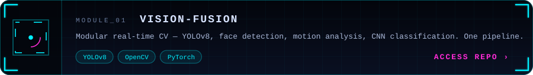</a>
<a href="https://github.com/kshitiz-arc/AirVolumeControl">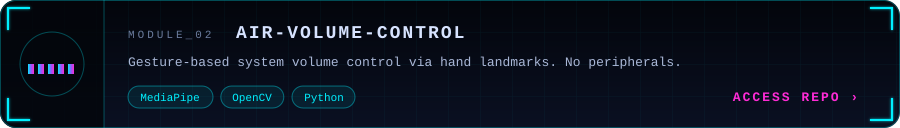</a>
<a href="https://github.com/kshitiz-arc/Handwriting_Emotion_Detection">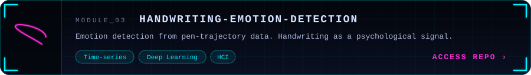</a>

 


<code>CORE.LANG</code> 

<code>NEURAL.CORE  //  VISION.ARRAY</code> 

<code>INTERFACE.LAYER  //  INFRA.GRID</code> 

 


<picture>
  <source media="(prefers-color-scheme: dark)" srcset="https://raw.githubusercontent.com/kshitiz-arc/kshitiz-arc/output/github-snake-dark.svg"/>
  <source media="(prefers-color-scheme: light)" srcset="https://raw.githubusercontent.com/kshitiz-arc/kshitiz-arc/output/github-snake.svg"/>
  
</picture>

  


 

